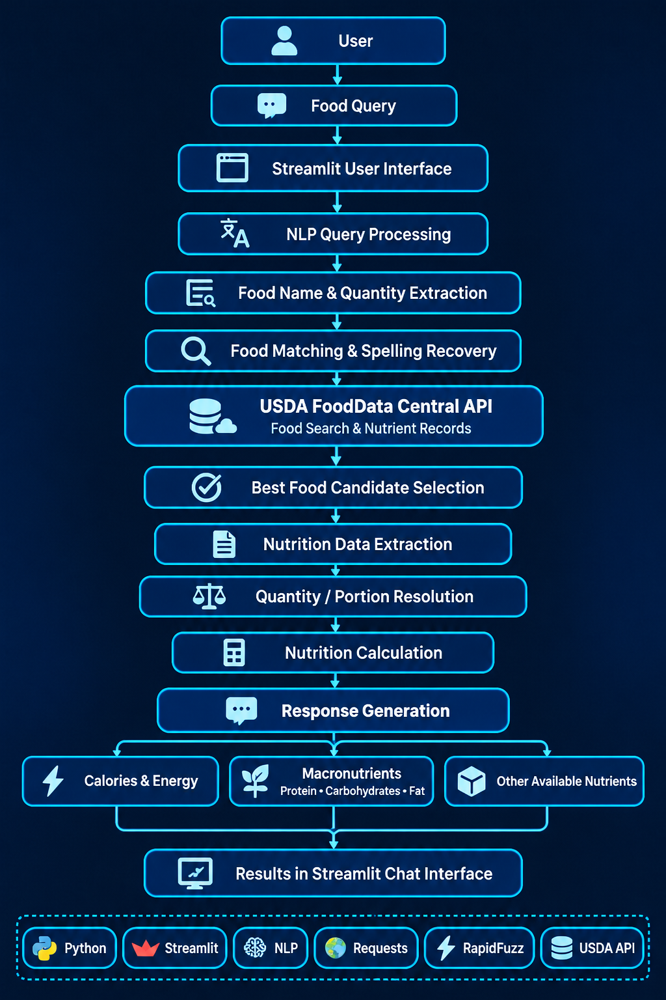
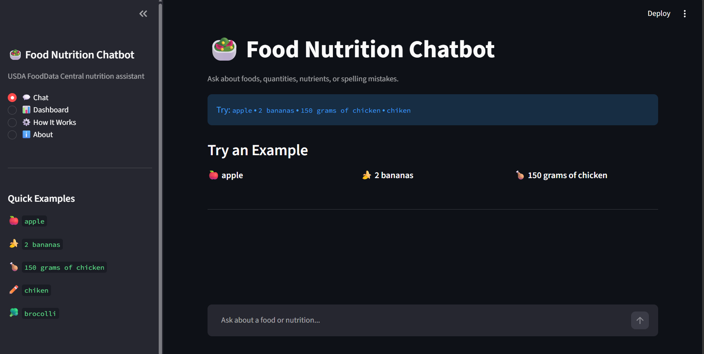

# 🥗 NutriBot — Food Nutrition Chatbot Using NLP

**Understand what's in your food, one query at a time.**

NutriBot is an interactive food nutrition chatbot built using Python, Natural Language Processing (NLP), and Streamlit. It helps users explore nutritional information by entering food names and supported quantity-based queries.

By integrating USDA FoodData Central, NutriBot searches food records, evaluates potential matches, retrieves available nutrient information, and presents results through an interactive dashboard.

<p align="center">
  
  
  
  
</p>

> **Project focus:** Transforming everyday food queries into structured nutrition information through text processing, food matching, database retrieval, and quantity-based calculations.

---

## 📑 Table of Contents

- [🌟 About the Project](#-about-the-project)
- [🎯 Project Objectives](#-project-objectives)
- [✨ Key Features](#-key-features)
- [🖥️ Dashboard Workflow](#️-dashboard-workflow)
- [🥗 Nutrition Information](#-nutrition-information)
- [⚖️ Quantity and Serving Support](#️-quantity-and-serving-support)
- [🔎 Food Matching and Ranking](#-food-matching-and-ranking)
- [🛡️ Safe Handling of Unknown Foods](#️-safe-handling-of-unknown-foods)
- [🏗️ System Architecture](#️-system-architecture)
- [⚙️ Methodology](#️-methodology)
- [📊 Results and Visualization](#-results-and-visualization)
- [📸 Application Screenshots](#-application-screenshots)
- [🛠️ Technology Stack](#️-technology-stack)
- [📂 Project Structure](#-project-structure)
- [🚀 Installation and Setup](#-installation-and-setup)
- [▶️ Running the Application](#️-running-the-application)
- [🧪 Testing](#-testing)
- [⚠️ Limitations](#️-limitations)
- [🔮 Future Enhancements](#-future-enhancements)
- [📚 Data Source](#-data-source)
- [👩‍💻 Author and Connect](#-author-and-connect)

---

## 🌟 About the Project

NutriBot is designed to make food nutrition information easier to access and understand.

Users can enter food names and supported food-related queries through the dashboard. The application processes the input, attempts to identify the requested food and quantity, searches USDA FoodData Central, and presents the available nutritional information.

Unlike a system that relies entirely on a small, predefined list of foods, NutriBot uses an external nutrition database and food-matching logic to search for relevant food records.

The project combines NLP techniques, spelling-error handling, food identification, API communication, nutrition calculations, and response generation in a single application.

## 🎯 Project Objectives

The main objectives of NutriBot are:

- Develop an interactive chatbot for exploring food nutrition information.
- Process supported food-related queries using NLP techniques.
- Retrieve food and nutrient records from USDA FoodData Central.
- Improve food identification through text similarity and spelling recovery.
- Interpret supported quantities, units, and serving descriptions.
- Calculate nutrient amounts for compatible quantities and nutrition bases.
- Reduce incorrect food selections through candidate ranking.
- Handle unknown foods without presenting fabricated nutrition values.
- Display nutrition results through a user-friendly dashboard.

## ✨ Key Features

### 💬 Natural Language Food Queries

Allows users to enter supported food-related queries in a simple, conversational format.

### 🔍 Dynamic Food Search

Uses USDA FoodData Central to search available food records instead of depending exclusively on a fixed food list.

### ✏️ Spelling-Error Handling

Uses text normalization and algorithmic spelling-recovery strategies to help identify intended food names when possible.

### ⚖️ Quantity and Portion Processing

Attempts to identify food quantities, measurement units, and supported portion information.

### 🧮 Nutrition Calculation

Scales available nutrient values according to a requested quantity when the selected record and conversion logic support the calculation.

### 🏆 Food Matching and Ranking

Evaluates candidate food records using text similarity, descriptions, data type priority, and other implemented selection criteria.

### 🛡️ Unknown-Food Handling

Supports a safer nutrition lookup approach by avoiding unsupported nutrition values when a reliable match cannot be identified.

### 🖥️ Interactive Dashboard

Provides a Streamlit interface for entering queries and viewing nutrition results and available food details.

---

## 🖥️ Dashboard Workflow

The dashboard is the main interface through which users interact with NutriBot. When a user submits a food query, the application processes the input through multiple stages before displaying the result.

The following example illustrates the intended processing flow for the query `I ate 200g banana`.

### 1️⃣ User Input

The user enters a food-related query through the dashboard.

```text
I ate 200g banana
```

The input can contain a food name, a quantity, a unit, and additional words describing the request.

### 2️⃣ Text Normalization

The application cleans and normalizes the input to make subsequent processing and text matching more consistent.

For example, unnecessary whitespace can be removed and text can be normalized for comparison.

### 3️⃣ Spelling Recovery

The application attempts to recover from common spelling errors using its text-processing and food-matching logic.

Example:

```text
chickwn → chicken
```

Spelling recovery is an attempt to improve the search query, not a guarantee that every misspelling will be corrected.

### 4️⃣ Food Extraction

The application identifies the food name needed for the nutrition lookup.

Example:

```text
banana
```

### 5️⃣ Quantity Extraction

The application attempts to identify the requested amount.

Example:

```text
200
```

The extracted quantity must be interpreted alongside its unit.

### 6️⃣ Unit Detection

The application attempts to identify the measurement unit associated with the quantity.

Example:

```text
g
```

Together, the extracted quantity and unit represent a request for 200 grams of banana.

### 7️⃣ Intent Processing

The application processes the query to determine the requested food-related operation, where supported.

For this example, the intended operation is nutrition lookup.

```text
nutrition
```

### 8️⃣ USDA Food Retrieval

The extracted food name is searched through the USDA FoodData Central API.

The API may return multiple candidate food records. The first result is not necessarily the most suitable match.

### 9️⃣ Food Matching and Selection

The matching logic evaluates available candidates and attempts to select a suitable record.

Factors can include food-description similarity, data type priority, and whether the record appropriately represents the requested food.

### 🔟 Nutrient Extraction and Calculation

The application retrieves available nutrient values from the selected food record.

When the requested quantity and the record's nutrition basis are compatible, the application scales the nutrient values to the requested amount.

For example, if a nutrient is reported per 100 g, the scaling factor for 200 g is:

\[
\text{Scaling factor}=\frac{200}{100}=2
\]

The calculation uses the actual nutrient values from the selected record.

### 1️⃣1️⃣ Response Generation

The response-generation component formats the processed information for display.

The dashboard presents the available nutrition results and food details. If a reliable match cannot be established, the application should avoid confidently presenting an unrelated food as the requested food.

The exact behavior depends on the query, API results, and the implemented processing logic.

---

## 🥗 Nutrition Information

NutriBot extracts available nutrient information from the selected USDA food record.

| Nutrient | Unit |
|---|---|
| 🔥 Calories / Energy | kcal, where available |
| 💪 Protein | g |
| 🍞 Carbohydrates | g |
| 🥑 Total Fat | g |
| 🌾 Fiber | g |
| 🍬 Sugar | g |
| 🦴 Calcium | mg |
| 🩸 Iron | mg |
| 🧂 Sodium | mg |
| 🍊 Vitamin C | mg |

The nutrients available can vary between food records. This list describes important nutrients of interest and does not guarantee that every record contains every listed nutrient.

The application should preserve the units and values supplied by the selected record and avoid treating missing nutrient values as zero unless that behavior is explicitly supported by the data and calculation logic.

---

## ⚖️ Quantity and Serving Support

NutriBot is designed to process supported food queries that include quantities or portions.

Example query formats:

```text
100g banana
200g apple
1 kg rice
2 apples
1 serving
```

Queries such as `500 mg food` also contain a quantity and unit, but meaningful nutrition calculations depend on whether the unit can be interpreted appropriately for the selected food.

### 🧮 Nutrition Calculation

When a food record provides nutrient values per 100 grams, NutriBot calculates the nutrient amount for the requested quantity using the following formula:

**Formula:**

```text
Nutrient Amount = (Nutrient per 100 g × Requested Weight in g) / 100
```

**Example: Calculating nutrition for 200 g**

Suppose a selected food record provides 10 g of a nutrient per 100 g.

```text
Nutrient Amount = (10 × 200) / 100
                = 20 g
```

Therefore, the calculated amount is **20 g of that nutrient for 200 g of food**.

*This is an illustrative calculation, not a measured nutrition value for a particular food.*


### 📏 Unit and Serving Considerations

- Weight units must be converted consistently before calculation.
- Serving-based quantities require suitable serving-weight information.
- Food records can use different nutrient bases.
- Ambiguous quantities may require further clarification.
- Unsupported conversions can prevent a reliable calculation.

The result depends on correct food matching, quantity interpretation, and the nutrition data available for the selected record.

---

## 🔎 Food Matching and Ranking

USDA FoodData Central may return multiple records for the same search term. NutriBot uses food-matching and ranking logic to help identify a relevant record instead of automatically accepting the first API result.

### 🏆 Candidate Evaluation

The implemented matching logic can consider:

- Text similarity between the user query and food description
- Similarity after spelling normalization
- Whether the food description starts with the requested name
- USDA data type priority
- Generic versus specialized food descriptions
- Preparation-related terms
- A minimum similarity threshold

The selected record depends on the actual scoring rules and the candidates returned by the API.

### 🍗 Example: Selecting a Suitable Food

Consider the query:

```text
User: chicken
```

The database may return records for plain chicken, prepared chicken dishes, and branded products.

For a generic query, a record representing plain chicken may be more appropriate than an unrelated specialized product.

However, the intended preparation matters. Raw chicken and cooked chicken can have different nutrient profiles, so the selected record should reflect what the user intends to describe.

### 🔍 Why the First Match Is Not Always Correct

A food description can contain the requested keyword without being an appropriate match.

For example, a query for a generic food might return:

```text
Chicken
Chicken spread
Chicken kiev
Chicken-flavored snack
```

The matching system should evaluate the full descriptions and other relevant criteria rather than treating every partial text match as correct.

### ✏️ Spelling Recovery and Ranking Are Different

The process has two distinct purposes:

1. **Spelling recovery:** Attempts to generate a more useful search query.
2. **Food ranking:** Evaluates the retrieved candidates to select a suitable record.

Correcting a spelling error does not prove that the selected food is correct. The retrieved records must still be evaluated.

---

## 🛡️ Safe Handling of Unknown Foods

Nutrition information should be based on a suitable food record rather than invented values.

For example, consider an input such as:

```text
xyzabc food
```

If the application cannot identify a sufficiently reliable match, it should inform the user that nutrition information could not be found.

Example response:

```text
I couldn't find reliable nutrition information for
"xyzabc food" in the current food database.

Please try another food name or provide a more
specific description.
```

This illustrates the intended behavior; the exact message depends on the application's response-generation implementation.

### 🔐 Why This Matters

- Reduces the risk of displaying nutrition values for unrelated foods.
- Separates retrieved nutrition information from unsupported assumptions.
- Encourages more specific food descriptions when a query is ambiguous.
- Makes the limitations of the lookup process clearer to users.

A similarity score alone does not guarantee that a food match is nutritionally appropriate.

---

## 🏗️ System Architecture

The system architecture represents the main components involved in processing a food query, retrieving nutrition data, calculating nutrient values, and presenting the response.



### 🧩 Architecture Components

**1. Streamlit Dashboard**

Accepts user queries and displays nutrition results.

**2. Chatbot Module**

Coordinates the query-processing and response workflow.

**3. NLP Processor**

Processes supported natural-language input.

**4. Food Matcher**

Evaluates food candidates and helps select a relevant record.

**5. Nutrition Database Module**

Communicates with USDA FoodData Central to search for foods and retrieve detailed nutrition information.

**6. Portion Resolver**

Handles supported quantity and serving interpretation.

**7. Nutrition Calculator**

Calculates nutrient amounts for supported quantities and compatible nutrition bases.

**8. Response Generator**

Formats the processed information for presentation through the dashboard.

The exact execution path depends on the query and the application's implementation.

---

## ⚙️ Methodology

NutriBot follows a series of processing stages to transform a food query into a nutrition response.

### 📝 Input Collection

The user enters a food name or supported food-related query.

### 🧹 Text Processing

The input is normalized and prepared for subsequent processing.

### ✏️ Spelling Recovery

The application attempts to handle common spelling errors using generic text-processing techniques.

### 🔍 Food Identification

The application identifies the food search term and queries the external nutrition database.

### ⚖️ Quantity Processing

Supported amounts, units, and serving descriptions are interpreted.

### 🌐 Nutrition Data Retrieval

USDA FoodData Central returns candidate records and, when requested, detailed nutrition information.

### 🏆 Candidate Ranking

The food-matching logic evaluates candidate descriptions and selects a suitable record when possible.

### 🧪 Nutrient Extraction

Available nutrient values and units are extracted from the selected food record.

### 🧮 Nutrition Calculation

The application calculates nutrient amounts for supported quantities when the necessary data and conversions are available.

### 💬 Response Generation

The processed information is formatted and presented through the Streamlit dashboard.

---

## 📊 Results and Visualization

The results interface presents nutritional information retrieved and processed by NutriBot. The exact values depend on the selected food record, the requested quantity, and the nutrient information available.

### 🥗 Nutrition Metric Analysis

The application can present available nutrition metrics, including:

- Energy and calories
- Protein
- Carbohydrates
- Total fat
- Fiber
- Sugar
- Minerals and vitamins where available

Not every food record contains the same nutrient information.

### ⚖️ Quantity-Based Analysis

For supported queries, NutriBot uses the interpreted quantity and the selected record's nutrition basis to calculate nutrient amounts.

The calculation should use compatible units and a suitable reference amount. Serving-based calculations additionally require appropriate serving information.

### 🔍 Food Matching Results

The food-matching process evaluates candidate records using the application's text-similarity and selection logic.

Spelling recovery may help with mistyped food names, but it cannot guarantee that every input will produce a correct match.

### 📋 Result Interpretation

Nutrition results should be interpreted in the context of:

- The selected food record
- The preparation method and description
- The requested quantity or portion
- The units and nutrient basis
- The availability of nutrient data

The displayed information is intended for general nutrition exploration and is not a substitute for professional medical or dietary advice.

---

## 📸 Application Screenshots

The following screenshots illustrate the main interface and nutrition information views.

### 🏠 Dashboard

The Dashboard provides the main interface for entering food queries and interacting with the chatbot.



### 📊 Nutrition Results

The Nutrition Results view presents an example of the nutrition information returned by the application.


### 🥗 Full Nutrition Details

The Full Nutrition Details view presents the available nutritional information for a selected food.


---

## 🛠️ Technology Stack

| Technology | Purpose |
|---|---|
| 🐍 Python | Core application logic |
| 🖥️ Streamlit | Interactive dashboard |
| 🧠 NLP techniques | Food-query processing |
| 🌐 USDA FoodData Central API | Food and nutrient data retrieval |
| 🔗 Requests | HTTP communication |
| 🔐 python-dotenv | Environment variable configuration |
| 🔎 RapidFuzz | Text similarity and matching |

---

## 📂 Project Structure

```text
food-nutrition-chatbot/
├── app.py
├── chatbot.py
├── nlp_processor.py
├── food_matcher.py
├── nutrition_database.py
├── nutrition_calculator.py
├── portion_resolver.py
├── response_generator.py
├── train_model.py
├── test_api.py
├── test_matcher.py
├── test_nlp.py
├── requirements.txt
├── RUN_NUTRIBOT.bat
├── .gitignore
├── README.md
├── docs/
│   └── images/
│       └── system-architecture.png
└── results/
    └── screenshots/
        ├── Dashboard.png
        ├── Nutrition Results.png
        └── Full Details.png
```

The local `.env` file contains the private USDA API key and should be excluded from the public repository through `.gitignore`.

---

## 🚀 Installation and Setup

### 📋 Prerequisites

Before running NutriBot, ensure you have:

- Python 3.12 or a compatible version
- Git
- A USDA FoodData Central API key
- An internet connection for API requests

### 1️⃣ Clone the Repository

```bash
git clone https://github.com/KeerthiThokala029/food-nutrition-chatbot.git
cd food-nutrition-chatbot
```

### 2️⃣ Create a Virtual Environment

```bash
python -m venv venv
```

Activate the environment on Windows:

```powershell
venv\Scripts\activate
```

### 3️⃣ Install Dependencies

```bash
pip install -r requirements.txt
```

### 4️⃣ Configure the API Key

Create a `.env` file in the project root directory:

```env
USDA_API_KEY=your_api_key_here
```

Get an API key and review the documentation at the [USDA FoodData Central API Guide](https://fdc.nal.usda.gov/api-guide/).

Replace the placeholder with your own key. Do not share your actual API key or commit the `.env` file to GitHub.

---

## ▶️ Running the Application

Activate your virtual environment and run:

```bash
streamlit run app.py
```

Alternatively, on Windows, launch:

```text
RUN_NUTRIBOT.bat
```

Streamlit will display a local URL in the terminal. Open that URL in your browser to use the NutriBot dashboard.

---

## 🧪 Testing

The project includes test scripts for checking different components.

| Test File | Purpose |
|---|---|
| `test_api.py` | API-related checks |
| `test_matcher.py` | Food-matching checks |
| `test_nlp.py` | NLP processing checks |

For example, run:

```bash
python test_matcher.py
```

Run tests from the project directory with the virtual environment activated. API-related tests may require internet access and a valid API key.

---

## ⚠️ Limitations

- Results depend on the food records available through USDA FoodData Central.
- Not every food record provides every nutrient listed in this README.
- Spelling recovery and text-similarity matching cannot guarantee a correct match for every query.
- Raw, cooked, branded, and prepared foods may have different nutrition profiles.
- Quantity calculations depend on correct input interpretation and compatible units.
- Serving-based calculations require suitable serving-weight information.
- API searches require internet access and valid API configuration.
- Nutrition information should not be treated as medical advice.

---

## 🔮 Future Enhancements

Potential improvements include:

- 📈 Interactive nutrition charts
- 🍽️ Meal-wise nutrition summaries
- 🗓️ Daily food and nutrition history
- 🧠 Improved food-name and intent recognition
- ⚖️ Expanded serving and unit conversion support
- 🔍 Better handling of ambiguous food matches
- 📱 Improved mobile dashboard layout
- ☁️ Public deployment and hosting

---

## 📚 Data Source

NutriBot uses **[USDA FoodData Central](https://fdc.nal.usda.gov/)** as its external food and nutrition data source.

The API supplies food records and nutrient information. NutriBot uses its search, matching, and nutrition-processing logic to select records and present the information returned by the database.

The availability of specific nutrients and serving details depends on the selected food record.

---

## 👩‍💻 Author and Connect

<div align="center">

### Keerthi Thokala

🎓 B.Tech(AI&ML) Student


### 🔗 Connect With Me

**GitHub**

[KeerthiThokala029](https://github.com/KeerthiThokala029)

**Project Repository**

[food-nutrition-chatbot](https://github.com/KeerthiThokala029/food-nutrition-chatbot)

---

**🥗 NutriBot**

*Making food nutrition information easier to explore, one query at a time.*

</div>